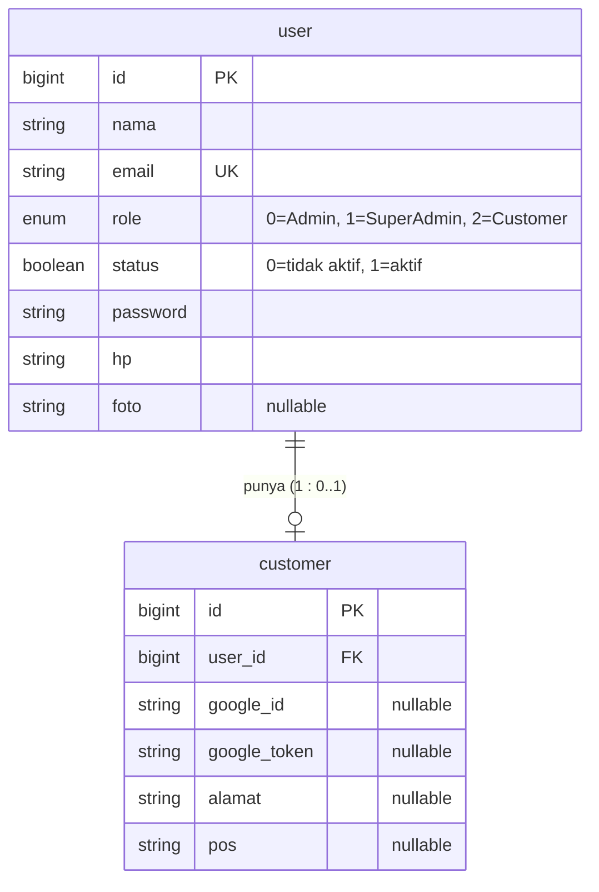
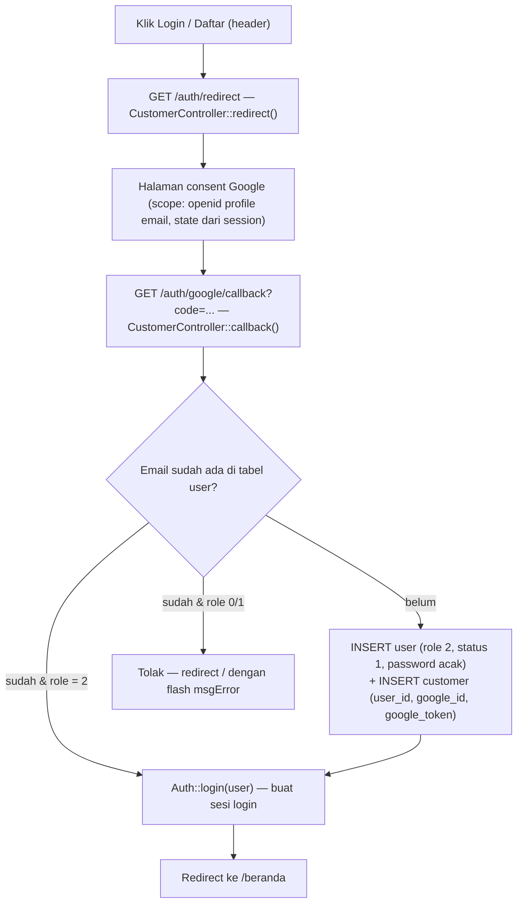

# Blueprint Customer — TokoOnlineBaru

Web Programming III · disusun 17 Oktober 2026 · status: **sudah diimplementasikan (Week 3)**

Fitur customer: registrasi & login memakai akun Google (Laravel Socialite). Identitas akun
disimpan di tabel `user` (dipakai bersama admin), sedangkan data khusus customer disimpan di
tabel `customer`. Saat login pertama kali, satu baris `user` (role 2) **dan** satu baris
`customer` dibuat sekaligus, dihubungkan lewat kolom `customer.user_id`.

---

## 1. Entity Relationship Diagram



Bentuk sederhana:

```
user  (1) ────── (0..1)  customer
        satu akun user maksimal punya satu data customer;
        satu data customer pasti terhubung ke tepat satu user.
```

---

## 2. Tabel `user` — identitas akun (sejak Web Programming II)

File: `database/migrations/2014_10_12_000000_create_user_table.php`

| Kolom | Tipe | Constraint | Keterangan |
| --- | --- | --- | --- |
| `id` | `BIGINT UNSIGNED` | PK, auto-increment | |
| `nama` | `VARCHAR(255)` | NOT NULL | nama lengkap — untuk customer diambil dari profil Google |
| `email` | `VARCHAR(255)` | NOT NULL, **UNIQUE** | kunci pencocokan saat login Google |
| `role` | `ENUM('0','1','2')` | NOT NULL, default `'0'` | `0` = Admin, `1` = SuperAdmin, `2` = Customer |
| `status` | `TINYINT(1)` | NOT NULL | `0` = belum aktif, `1` = aktif (customer Google dibuat langsung `1`) |
| `password` | `VARCHAR(255)` | NOT NULL | hash bcrypt — customer Google memakai string acak 32 karakter |
| `hp` | `VARCHAR(13)` | NOT NULL | nomor HP — customer Google diisi `''`, dilengkapi nanti di halaman akun |
| `foto` | `VARCHAR(255)` | NULL | foto profil |
| `created_at`, `updated_at` | `TIMESTAMP` | NULL | |

---

## 3. Tabel `customer` — data spesifik customer (Week 3)

File: `database/migrations/2026_10_17_120000_create_customer_table.php`

| Kolom | Tipe | Constraint | Keterangan |
| --- | --- | --- | --- |
| `id` | `BIGINT UNSIGNED` | PK, auto-increment | |
| `user_id` | `BIGINT UNSIGNED` | NOT NULL, **FK → `user.id`**, `ON DELETE CASCADE` | penghubung ke akun; ikut terhapus bila user dihapus |
| `google_id` | `VARCHAR(255)` | NULL | ID unik akun Google (contoh: `103460705562398712788`) |
| `google_token` | `VARCHAR(255)` | NULL | access token OAuth terakhir dari Google (contoh prefix: `ya29.`) |
| `alamat` | `VARCHAR(255)` | NULL | alamat pengiriman — terisi saat checkout (Week 9) |
| `pos` | `VARCHAR(255)` | NULL | kode pos — terisi bersama alamat |
| `created_at`, `updated_at` | `TIMESTAMP` | NULL | |

Kolom `google_id`, `google_token`, `alamat`, dan `pos` sengaja **nullable** karena terisi
bertahap: saat login Google, lalu saat customer melengkapi akun / checkout.

---

## 4. Aturan data (business rules)

1. **Satu email = satu akun** (`user.email` UNIQUE). Login Google mencari berdasarkan email;
   email yang sudah terdaftar tidak membuat akun baru.
2. **`role = 2` khusus customer.** Akun admin (`0` / `1`) tidak boleh login lewat Google —
   percobaan seperti itu ditolak dengan pesan *"Email ini terdaftar sebagai akun admin,
   silakan login melalui halaman backend."* Admin hanya login dari `/backend/login`.
3. **Password customer Google selalu string acak ber-hash** (`Hash::make(Str::random(32))`) —
   tidak ada login password biasa untuk customer; satu-satunya jalan masuk adalah Google.
4. **Customer baru langsung aktif** (`status = 1`).
5. **Relasi 1 : 0..1** — user boleh tidak punya data customer (contoh: admin); customer selalu
   punya tepat satu user.
6. **Penghapusan berantai**: hapus `customer` → baris `user`-nya ikut terhapus (hook `deleting`
   di model `Customer`); hapus `user` → baris `customer` ikut terhapus (aturan FK cascade).
7. `alamat` & `pos` boleh kosong sampai customer mengisinya.

---

## 5. Alur data login Google



Langkah singkat:

1. Customer klik **Login/Daftar** di header → `GET /auth/redirect` (`auth.redirect`).
2. `CustomerController::redirect()` mengarahkan browser ke `accounts.google.com`
   (`client_id`, `redirect_uri`, scope `openid profile email`, `state` disimpan di session).
3. Customer memilih akun & menyetujui → Google kembali ke `GET /auth/google/callback`
   (`auth.callback`) membawa `code`; Socialite memvalidasi `state` dan menukar `code`
   dengan token + profil user.
4. `CustomerController::callback()`:
   - cari `user` berdasarkan email Google;
   - **belum ada** → buat `user` (role `2`, status `1`, password acak) lalu `customer`
     (`user_id`, `google_id`, `google_token`);
   - **sudah ada dengan role 2** → langsung dipakai (tidak ada data ganda);
   - **sudah ada dengan role 0/1** → ditolak;
   - `Auth::login($user)` menyimpan sesi login.
5. Redirect ke `/beranda`. Semua kegagalan → redirect `/` dengan flash `msgError`.

---

## 6. Query verifikasi

```sql
SELECT u.id, u.nama, u.email, u.role, u.status, c.google_id
FROM user u
JOIN customer c ON c.user_id = u.id
ORDER BY u.id DESC;
```

Contoh hasil uji (17 Oktober 2026): user `id = 6`, `rahmat mubarok`, role `2`, status `1`,
customer dengan `google_id = 103460705562398712788`.

---

## 7. File terkait

| File | Fungsi |
| --- | --- |
| `database/migrations/2014_10_12_000000_create_user_table.php` | tabel `user` (dari WP II) |
| `database/migrations/2026_10_17_120000_create_customer_table.php` | tabel `customer` (Week 3) |
| `app/Models/User.php` | model `User` |
| `app/Models/Customer.php` | model `Customer` (`$fillable`, relasi `user()`, hook `deleting`) |
| `app/Http/Controllers/CustomerController.php` | `redirect()`, `callback()`, `logout()` |
| `routes/web.php` | route `auth.redirect`, `auth.callback`, `logout` |
| `config/services.php` + `.env` | kredensial OAuth Google (`GOOGLE_CLIENT_ID`, `GOOGLE_CLIENT_SECRET`, `GOOGLE_REDIRECT_URL`) |
